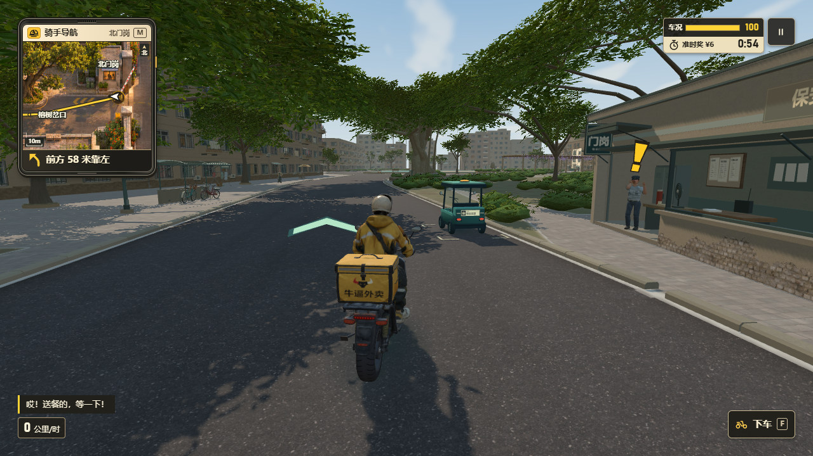

# 牛逼外卖 · 第一天

一款发生在中国老小区里的第三人称 3D 送餐游戏。AI 裁员后的第一份订单，从牛逼广场出发，到红棚烧腊取餐，穿过门岗，最后要亲手交到 7 号楼三层 302 室。

**[点这里直接玩](https://kwewqwe2-hue.github.io/aholo3d/)**　·　[观看广告片](https://kwewqwe2-hue.github.io/aholo3d/trailer.mp4)　·　[阅读项目报告 PDF](https://kwewqwe2-hue.github.io/aholo3d/report.pdf)　·　[下载离线试玩](https://github.com/kwewqwe2-hue/aholo3d/releases/download/v0.3.0/Niubi-Express-Day1-Offline.html)



## 这一单怎么送

翻完三页漫画，选择「第一天」并接单。跟左上角的常驻手机导航到店，刹停装餐。骑手越过门线时，保安才喊停、登车追上来。球场外圈宽，紫藤花架路短。到了楼下，自选停车位置，下车取袋、上楼、敲门。送达有 18 元基础工资，65 秒内加 6 元准时奖。车况归零扣 6 元，可以重试。

| 场景 | 键鼠 | 触屏 |
| --- | --- | --- |
| 骑车 | W/S 油门与刹车，A/D 转向，空格手刹，Shift 冲刺，Q/E 左右侧踢 | 转向、油门、刹车与侧踢按钮 |
| 步行 | 停稳按 F 上下车，WASD 移动，Shift 跑，拖动或 J/L 转镜头 | 摇杆、按住跑、滑动环顾 |
| 交接和导航 | Enter 在店前装餐、尾箱取袋或 302 敲门。M 展开手机，Esc 暂停，V 静音 | 点当前动作或左上角手机 |

室外导航跟随当前操控的骑手，进楼自动切换到所在楼层。游戏使用浏览器 WebGL 2，所有运行素材与网页同源。另有[单文件备用试玩](https://kwewqwe2-hue.github.io/aholo3d/offline.html)，加载完成后可断网继续。下载版双击 HTML 即可离线游玩。

2026 年 11 月 21 日，重庆电信、武汉联通和广州移动节点直接打开了游戏首页。三家运营商的大陆节点也取回了游戏程序、引擎、骑手模型和手机地图。另在公开网址用键盘完成 302 签收，回执 24 元。[大陆节点记录](reports/大陆直连实测.json) · [试玩与版本验收](reports/)

早期的晴天与暴雨两单玩法也可单独打开。第二单会遇上封闸，送完两单查看当天账单。[进入双单原型](https://kwewqwe2-hue.github.io/aholo3d/?classic=1)

## 项目目录

| 位置 | 内容 |
| --- | --- |
| [game](game/) | 可编辑的 Three.js 游戏源码、运行用纹理和 GLB、关卡规则、音频、构建与测试 |
| [game/art/Lux3D/assets](game/art/Lux3D/assets/) | 三份 Aholo 生成原件，含完整站姿骑手、摩托车和住宅楼 |
| [art](art/) | 采用的视觉目标、Blender 制作文件与关键资产对照 |
| [docs](docs/) | 正在提供试玩的 GitHub Pages 静态网页 |
| [reports](reports/) | 正式 PDF、早期归档、版本验收及大陆节点测试结果 |
| [media](media/) | 宣传视频、海报和真实游戏画面 |
| [licenses](licenses/) | 第三方材料来源与依赖许可证 |

## 本地运行

建议 Node.js 22.12 以上。在终端中运行以下命令。

```sh
cd game
npm ci
npm run dev
```

开发预览地址为 `http://127.0.0.1:5188/`。用 `npm run build:web` 生成可部署的 `dist-web/`，用 `npm run build` 生成 `dist/牛逼外卖-第一天.html`。游戏端无需模型服务的账号或密钥。

## 制作记录

骑手、车和北侧住宅来自 Aholo Lux3D 国内站。骑手完整网格经过关节绑定和步态细化，车轮、车把、尾箱盖和餐袋分别有自己的运动空间。楼道按真实可行走的四段折返梯建模，门洞、楼面与手机楼层图共用同一套坐标。静态楼道使用 Blender Cycles 烘焙间接光，人和车使用动态近影。[资产来源](licenses/ASSETS.md) · [正式报告](reports/牛逼外卖-项目报告书.pdf) · [本次发布](https://github.com/kwewqwe2-hue/aholo3d/releases/tag/v0.3.0)
